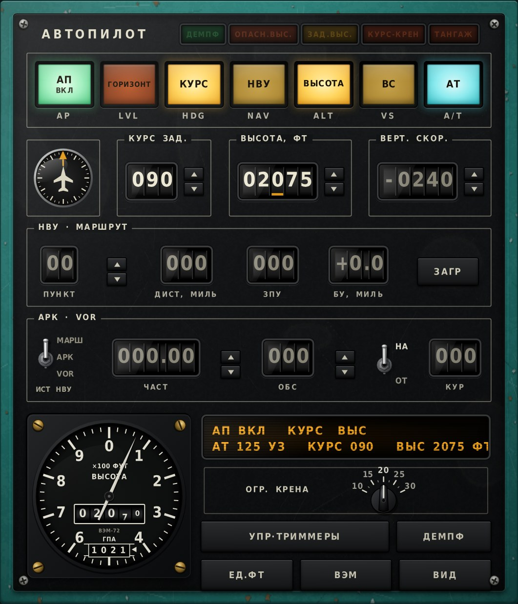
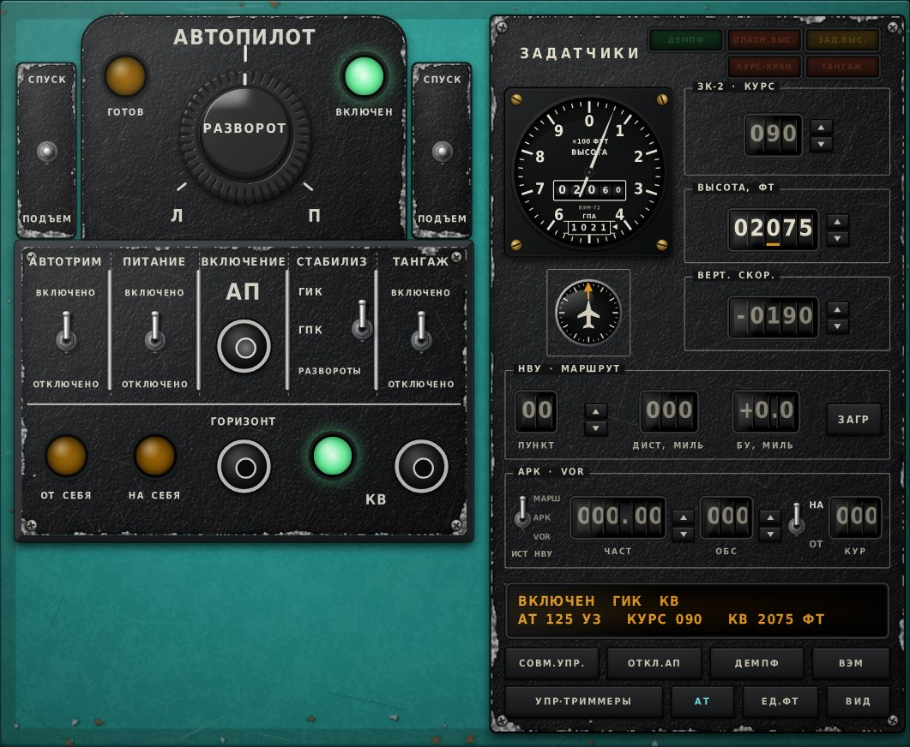

# AP-28 Autopilot Panel

**MSFS 2024 toolbar panel: a Soviet-style autopilot for aircraft that have none (made for the An-28).**

**[English](#english) · [Polski](#polski) · [Русский](#русский)** · 📋 **[Changelog / Historia zmian / История изменений](CHANGELOG.md)**

| Soviet cockpit skin | AP-28L1 replica skin |
|---|---|
|  |  |

---

## English

AP-28 Autopilot Panel is a toolbar panel for **Microsoft Flight Simulator 2024**. It flies the aircraft with its own autopilot logic, independent of the aircraft's systems. That way it works in aircraft with no autopilot, no VOR receiver and no autothrottle, such as the An-28. All labels are in Russian, like in a Soviet cockpit.

### Features

- **Autopilot modes**
  - АП (AP on/off)
  - ГОРИЗОНТ (wings level / emergency levelling)
  - КУРС (heading hold)
  - ВЫСОТА (altitude hold)
  - ВС (vertical speed)
  - НВУ (navigation)
  - Automatic disconnect, with КУРС-КРЕН and ТАНГАЖ warning lamps
  - Moving the throttle disconnects the autopilot (АП ОТКЛ: РУД)
- **НВУ navigation source switch** (ИСТ НВУ): МАРШ (route from the EFB, including SID/STAR points), АРК (ADF/NDB) or VOR.
- **Built-in virtual VOR receiver**
  - Finds stations in the sim's navigation database, then calculates radial and distance.
  - Receives ILS localizers (КРМ) too, with the course taken from the runway.
  - НА/ОТ (TO/FROM) switch, with automatic flip after station passage.
- **АТ autothrottle**
  - Holds indicated airspeed.
  - Disconnects when the pilot moves the throttle (Shift + click on АТ toggles this behaviour).
  - Also disconnects on touchdown.
  - Engine limiter (ОГР): never exceeds engine RPM, N1, torque or propeller RPM limits.
- **ДЕМПФ yaw damper** (rudder trim).
- **ВЭМ-72 altimeter**
  - Feet or metres (ЕД. button).
  - Drum counter.
  - Pressure window in mmHg or hPa.
- **Altitude alerts**
  - ОПАСН. ВЫС. (radio altitude below a threshold)
  - ЗАД. ВЫС. (selected altitude alerter)
- **Value changes reset the lower digits**: e.g. changing the tens of 3977 gives 3980.
- **Two skins**: a generic Soviet cockpit panel, and a replica of the AP-28L1 control panel.
- **Optional companion plugin**: the panel can talk to an external stream-deck plugin over `http://127.0.0.1:28650`. The plugin is not part of this repository, and the panel works fine without it.

### Installation (ready package)

1. Download the latest ZIP from **[Releases](../../releases)**.
2. Find your **Community** folder. Open `UserCfg.opt` in Notepad:
   - Steam: `%APPDATA%\Microsoft Flight Simulator 2024\UserCfg.opt`
   - Microsoft Store: `%LOCALAPPDATA%\Packages\Microsoft.Limitless_8wekyb3d8bbwe\LocalCache\UserCfg.opt`

   The last line, `InstalledPackagesPath "..."`, plus `\Community` is your Community folder.
3. Copy the `ap28-autopilot-panel` folder into Community. `manifest.json` must be directly inside `Community\ap28-autopilot-panel\`.
4. Start the sim and load a flight. The panel is under the toolbar icon with an aircraft on a dial.

### Building from source

1. Edit the readable source `src/AP28Panel.js`.
2. Run `python tools/build_js.py`. It writes the game file `project/PackageSources/html_ui/InGamePanels/AP28Panel/AP28Panel.js`, with non-ASCII characters escaped as `\uXXXX`.
3. In MSFS 2024, turn on Developer Mode. Then open **Project Editor → Open project → `project/ap28-autopilot-panel.xml`** and click **Build All in project**.
4. Copy `project/Packages/ap28-autopilot-panel` into your Community folder.

Settings such as PID gains, autothrottle and VOR options are in `AP_CONFIG` at the top of `src/AP28Panel.js`.

### Debug log

Hold the panel's text display for about 1.5 s to show the log under the panel.

### License

© 2026 JamJam. **All rights reserved.** You may view the source code, and use the mod for personal use. You may not redistribute, modify or sell it without written permission. See [LICENSE.txt](LICENSE.txt) and [THIRD-PARTY.txt](THIRD-PARTY.txt) (the glyph outlines come from the DejaVu font).

Microsoft Flight Simulator is a trademark of Microsoft. This mod is not affiliated with Microsoft.

---

## Polski

AP-28 Autopilot Panel to panel do paska narzędzi **Microsoft Flight Simulator 2024**. Steruje samolotem własnym autopilotem, niezależnym od systemów samolotu. Dzięki temu działa w maszynach bez autopilota, bez odbiornika VOR i bez automatu ciągu, np. w An-28. Wszystkie napisy są po rosyjsku, jak w radzieckiej kabinie.

### Funkcje

- **Tryby autopilota**
  - АП (włącz/wyłącz)
  - ГОРИЗОНТ (poziomowanie, także awaryjne)
  - КУРС (utrzymanie kursu)
  - ВЫСОТА (utrzymanie wysokości)
  - ВС (prędkość pionowa)
  - НВУ (nawigacja)
  - Automatyczne odłączenie z lampkami КУРС-КРЕН i ТАНГАЖ
  - Ruch przepustnicy wyłącza autopilota (АП ОТКЛ: РУД)
- **Przełącznik źródła НВУ** (ИСТ НВУ): МАРШ (trasa z EFB, także punkty SID/STAR), АРК (NDB) albo VOR.
- **Wbudowany wirtualny odbiornik VOR**
  - Szuka stacji w bazie nawigacyjnej symulatora, potem liczy radial i odległość.
  - Odbiera też ILS (КРМ), z kursem pasa.
  - Przełącznik НА/ОТ, z automatycznym przełączeniem po przelocie nad stacją.
- **АТ, automat ciągu**
  - Utrzymuje prędkość przyrządową.
  - Wyłącza się po ruszeniu przepustnicy (Shift + klik na АТ włącza lub wyłącza tę funkcję).
  - Wyłącza się też po przyziemieniu.
  - Ogranicznik silnika (ОГР): nie przekracza limitów obrotów, N1, momentu ani obrotów śmigła.
- **ДЕМПФ**, tłumik odchylenia (trymer steru kierunku).
- **Wysokościomierz ВЭМ-72**
  - Stopy albo metry (przycisk ЕД.).
  - Licznik bębnowy.
  - Okienko ciśnienia w mm Hg albo hPa.
- **Sygnalizacja wysokości**
  - ОПАСН. ВЫС. (wysokość radiowa poniżej progu)
  - ЗАД. ВЫС. (zbliżanie się do zadanej wysokości)
- **Zmiana wartości zeruje niższe cyfry**: np. 3977, zmiana dziesiątek daje 3980.
- **Dwa wyglądy**: radziecki pulpit oraz replika pulpitu AP-28L1.
- **Opcjonalna współpraca z zewnętrzną wtyczką** do stream decka, przez `http://127.0.0.1:28650`. Wtyczki nie ma w tym repozytorium, a panel działa bez niej.

### Instalacja (gotowa paczka)

1. Pobierz najnowszy ZIP z **[Releases](../../releases)**.
2. Znajdź folder **Community**. Otwórz Notatnikiem `UserCfg.opt`:
   - Steam: `%APPDATA%\Microsoft Flight Simulator 2024\UserCfg.opt`
   - Microsoft Store: `%LOCALAPPDATA%\Packages\Microsoft.Limitless_8wekyb3d8bbwe\LocalCache\UserCfg.opt`

   Ostatnia linia, `InstalledPackagesPath "..."`, plus `\Community` to Twój folder Community.
3. Skopiuj folder `ap28-autopilot-panel` do Community. `manifest.json` ma leżeć bezpośrednio w `Community\ap28-autopilot-panel\`.
4. Uruchom grę i wczytaj lot. Panel jest pod ikoną tarczy z samolotem w pasku narzędzi.

### Budowanie ze źródeł

1. Zmieniaj czytelne źródło `src/AP28Panel.js`.
2. Uruchom `python tools/build_js.py`. Skrypt zapisuje plik dla gry `project/PackageSources/html_ui/InGamePanels/AP28Panel/AP28Panel.js`, a znaki spoza ASCII zamienia na `\uXXXX`.
3. W MSFS 2024 włącz tryb dewelopera. Otwórz **Project Editor → Open project → `project/ap28-autopilot-panel.xml`** i kliknij **Build All in project**.
4. Skopiuj `project/Packages/ap28-autopilot-panel` do folderu Community.

Ustawienia, takie jak wzmocnienia PID, AT i VOR, są w `AP_CONFIG` na początku `src/AP28Panel.js`.

### Log diagnostyczny

Przytrzymaj wyświetlacz tekstowy panelu przez około 1,5 s, a pod panelem pojawi się log.

### Licencja

© 2026 JamJam. **Wszelkie prawa zastrzeżone.** Kod możesz oglądać, a moda używać na własny użytek. Bez pisemnej zgody autora nie wolno go rozpowszechniać, przerabiać ani sprzedawać. Szczegóły w [LICENSE.txt](LICENSE.txt) i [THIRD-PARTY.txt](THIRD-PARTY.txt) (kontury liter pochodzą z czcionki DejaVu).

Microsoft Flight Simulator jest znakiem towarowym firmy Microsoft. Mod nie jest z nią powiązany.

---

## Русский

AP-28 Autopilot Panel — панель для панели инструментов **Microsoft Flight Simulator 2024**. Она управляет самолётом собственным автопилотом, независимым от систем самолёта. Поэтому она работает на самолётах без автопилота, без приёмника VOR и без автомата тяги, например на Ан-28. Все надписи на русском языке, как в советской кабине.

### Возможности

- **Режимы автопилота**
  - АП (вкл/выкл)
  - ГОРИЗОНТ (приведение к горизонту, в том числе аварийное)
  - КУРС (стабилизация курса)
  - ВЫСОТА (стабилизация высоты)
  - ВС (вертикальная скорость)
  - НВУ (навигация)
  - Автоматическое отключение с табло КУРС-КРЕН и ТАНГАЖ
  - Перемещение РУД отключает автопилот (АП ОТКЛ: РУД)
- **Переключатель источника НВУ** (ИСТ НВУ): МАРШ (маршрут из EFB, включая точки SID/STAR), АРК или VOR.
- **Встроенный виртуальный приёмник VOR**
  - Ищет станции в навигационной базе симулятора, затем вычисляет радиал и дальность.
  - Принимает также курсовые маяки ILS (КРМ), с курсом ВПП.
  - Переключатель НА/ОТ, с автоматическим переключением после пролёта станции.
- **АТ — автомат тяги**
  - Выдерживает приборную скорость.
  - Отключается при перемещении РУД (Shift + щелчок по АТ включает или выключает эту функцию).
  - Отключается также при касании ВПП.
  - Ограничитель режима (ОГР): не превышает ограничений по оборотам, N1, крутящему моменту и оборотам винта.
- **ДЕМПФ** — демпфер рыскания (триммер руля направления).
- **Высотомер ВЭМ-72**
  - Футы или метры (кнопка ЕД.).
  - Барабанный счётчик.
  - Окно давления в мм рт. ст. или гПа.
- **Сигнализация высоты**
  - ОПАСН. ВЫС. (радиовысота ниже порога)
  - ЗАД. ВЫС. (подход к заданной высоте)
- **При изменении значения младшие разряды обнуляются**: например, 3977 при изменении десятков даёт 3980.
- **Два вида**: советский пульт и копия пульта АП-28Л1.
- **Необязательная связь с внешним плагином** для stream deck через `http://127.0.0.1:28650`. Плагина в этом репозитории нет, панель работает и без него.

### Установка (готовый пакет)

1. Скачайте последний ZIP в разделе **[Releases](../../releases)**.
2. Найдите папку **Community**. Откройте `UserCfg.opt` в Блокноте:
   - Steam: `%APPDATA%\Microsoft Flight Simulator 2024\UserCfg.opt`
   - Microsoft Store: `%LOCALAPPDATA%\Packages\Microsoft.Limitless_8wekyb3d8bbwe\LocalCache\UserCfg.opt`

   Последняя строка, `InstalledPackagesPath "..."`, плюс `\Community` — это ваша папка Community.
3. Скопируйте папку `ap28-autopilot-panel` в Community. `manifest.json` должен лежать прямо в `Community\ap28-autopilot-panel\`.
4. Запустите симулятор и загрузите полёт. Панель открывается значком с самолётом на шкале на панели инструментов.

### Сборка из исходников

1. Изменяйте читаемый исходник `src/AP28Panel.js`.
2. Запустите `python tools/build_js.py`. Скрипт записывает файл для игры `project/PackageSources/html_ui/InGamePanels/AP28Panel/AP28Panel.js`, символы вне ASCII записываются как `\uXXXX`.
3. В MSFS 2024 включите режим разработчика. Откройте **Project Editor → Open project → `project/ap28-autopilot-panel.xml`** и нажмите **Build All in project**.
4. Скопируйте `project/Packages/ap28-autopilot-panel` в папку Community.

Настройки, такие как коэффициенты ПИД, АТ и VOR, находятся в `AP_CONFIG` в начале `src/AP28Panel.js`.

### Журнал отладки

Удерживайте текстовое табло панели около 1,5 с, и под панелью появится журнал.

### Лицензия

© 2026 JamJam. **Все права защищены.** Код можно просматривать, а мод — использовать в личных целях. Без письменного разрешения автора его нельзя распространять, изменять или продавать. Подробности в [LICENSE.txt](LICENSE.txt) и [THIRD-PARTY.txt](THIRD-PARTY.txt) (контуры букв взяты из шрифта DejaVu).

Microsoft Flight Simulator — товарный знак Microsoft. Мод не связан с Microsoft.
